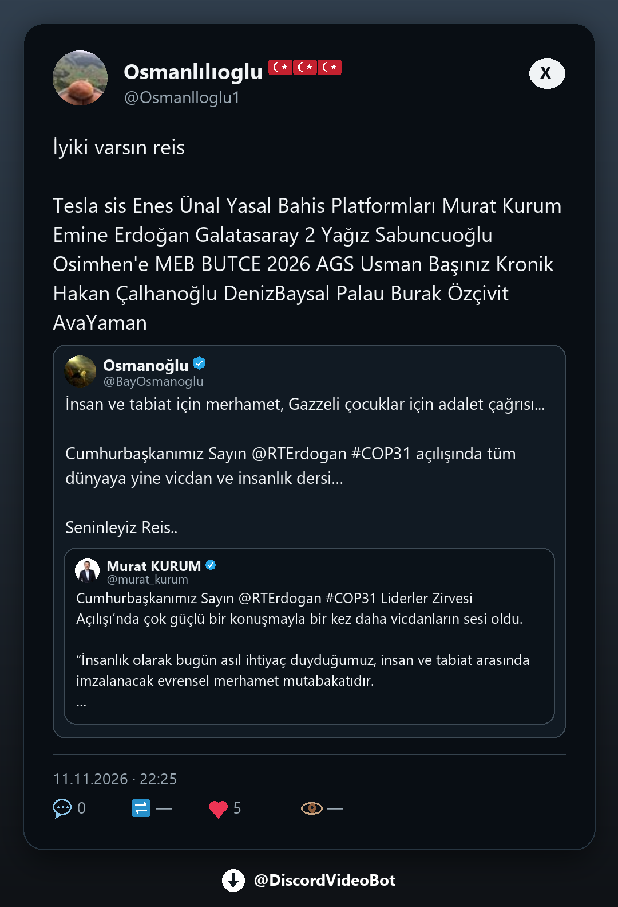

# Discord Video Downloader

Discord sohbetindeki sosyal medya bağlantılarını algılayıp medyayı ve erişilebilen gönderi metnini paylaşan Python botu. Platforma göre birden fazla ücretsiz sağlayıcıyı dener; ilk kullanılabilir tam sonucu gönderir.

## Desteklenen bağlantılar

| Platform | Bağlantı | Çıktı |
| --- | --- | --- |
| Instagram | Gönderi, reel, video | Fotoğraf/video galerisi, açıklama, kaynak düğmesi |
| TikTok | Video, fotoğraf | Medya galerisi, açıklama, kaynak düğmesi |
| Facebook | Gönderi, reel, video, fotoğraf | Medya galerisi, erişilebilen açıklama, kaynak düğmesi |
| X / Twitter | Tweet | Koyu tweet PNG kartı; varsa medya ayrıca |
| Reddit | Gönderi ve `/r/.../s/...` kısa bağlantısı | Metin koyu PNG sayfalarında; varsa medya ayrıca |
| YouTube | Video, Shorts, canlı yayın bağlantısı | MP3, 360p, 720p, 1080p düğmeleri |
| Spotify | Tekil parça | Eşleşen YouTube kaydından MP3, doğrudan dosya eki |
| Threads | Gönderi ve `/share/` bağlantısı | Normal gönderileri önce çerezsiz `threadsdl` web sağlayıcısıyla indirir; gerekirse oturumlu sayfa çözümlemesini dener. `/share/` bağlantısını `COOKIE_FILE` içindeki oturumla gerçek gönderiye çözer; çerez olmadan bu kısa bağlantı biçimi çalışmayabilir. |
| Douyin | Video, not | `yt-dlp` ve doğrudan sayfa yolları |
| Weibo | Gönderi | `gallery-dl` ve `yt-dlp` |
| Streamable | Video | Streamable API ve `yt-dlp` |
| Bluesky | Gönderi | Resmî açık API’den metin, alt metinli fotoğraf galerisi ve MP4 video; kaynak düğmesi |

Profil, arama, tüm albüm ve oynatma listesi bağlantıları topluca indirilmez. Özel gönderiler, oturum isteyen içerikler ve bölgesel engeller başarısız olabilir.



## Gereksinimler

- Python 3.11+.
- [FFmpeg](https://ffmpeg.org/download.html) ve `ffprobe` PATH üzerinde. Ses dönüştürme ve bazı videolarda ses/görüntü birleştirme için gerekir.
- Discord uygulaması, bot token'ı ve **Message Content Intent**.
- İsteğe bağlı: [Cobalt](https://github.com/imputnet/cobalt) için Docker veya Bun. Cobalt olmadan diğer sağlayıcılar çalışır. WSL zorunlu değildir.

Botun Python modülü Windows, Linux ve macOS'ta çalıştırılabilir. `.ps1` başlatma betikleri Windows içindir.

## Discord kurulumu

1. [Discord Developer Portal](https://discord.com/developers/applications) üzerinde uygulama ve bot oluşturup token alın.
2. **Bot → Privileged Gateway Intents → Message Content Intent** seçeneğini açıp kaydedin. Aksi halde `PrivilegedIntentsRequired` hatası alınır.
3. Botu sunucuya **View Channels**, **Read Message History**, **Send Messages** ve **Attach Files** izinleriyle ekleyin. Kanal izinlerini ayrıca kontrol edin.

## Windows'ta çalıştırma

PowerShell'de proje klasöründe:

```powershell
py -3 -m venv .venv
.\.venv\Scripts\python.exe -m pip install -r requirements.txt
Copy-Item .env.example .env
```

`.env` dosyasındaki `DISCORD_TOKEN` değerini kendi token'ınızla doldurun. `ffmpeg -version` komutunun çalıştığını kontrol edin.

```powershell
.\start-bot.ps1
```

Botu `Ctrl+C` ile durdurabilirsiniz. Linux/macOS'ta sanal ortamı etkinleştirip `python -m media_bot.bot` çalıştırın. Botun çevrimiçi kalması için çalıştığı makine açık kalmalıdır.

## `.env` ayarları

| Değişken | Varsayılan | Görevi |
| --- | --- | --- |
| `DISCORD_TOKEN` | Yok | Zorunlu bot token'ı |
| `CHANNEL_IDS` | Boş | Virgülle ayrılmış kanal ID'leri; boşsa erişilebilen tüm sunucu metin kanalları |
| `MAX_UPLOAD_MB` | `20` | Dosya başına yerel sınır; Discord sınırınıza uygun seçin |
| `YTDLP_REMOTE_EJS` | `0` | `1` olursa YouTube `yt-dlp` yedeği gerektiğinde GitHub’dan EJS betiği indirebilir; varsayılan kapalıdır |
| `MAX_LINKS_PER_MESSAGE` | `3` | Tek mesajda işlenen bağlantı sayısı; en fazla 10 |
| `MAX_CONCURRENT_JOBS` | `2` | Mesaj ve YouTube düğmesi işleri için toplam eşzamanlı sınır; en fazla 10 |
| `DATABASE_PATH` | `data/bot.sqlite3` | +18 kotası için SQLite dosyası |
| `COBALT_API_URL` | Boş | İsteğe bağlı Cobalt adresi, örn. `http://127.0.0.1:9000/` |
| `COBALT_API_KEY` | Boş | Cobalt örneği gerektiriyorsa anahtar |
| `COOKIE_FILE` | Boş | Erişim hakkınız olan hesabın çerez dosyası: Netscape biçimi veya tarayıcıdaki `Cookie:` başlığının tek satırlık ham hâli. Threads `/share/` bağlantıları ve oturum gerektiren gönderiler için kullanılır. |
| `GALLERY_DL_RS_PATH` | Boş | İsteğe bağlı `gallery-dl-rs` program yolu |

Kanal ID'si ve Cobalt anahtarı zorunlu değildir. Gerçek `.env`, çerezler, SQLite veritabanı ve geçici indirmeler Git'e eklenmez.

**Threads çerezi (isteğe bağlı):** `/share/...` kısa bağlantıları yalnızca giriş yapmış bir istemciye gerçek gönderiyi gösterir. Tarayıcıda threads.com'a giriş yapın, DevTools → Network → herhangi bir isteğin `Cookie:` başlığını kopyalayın, tek satır olarak bir dosyaya kaydedin ve `COOKIE_FILE` değişkenine o dosyanın yolunu yazın. Netscape biçimli `cookies.txt` de kabul edilir; ham başlık dosyası yalnızca botun kendi HTTP istemcilerinde kullanılır, `yt-dlp`/`gallery-dl` bu biçimi okuyamadığı için onlara verilmez. Bot gönderi sayfasından her işlemde güncel medya adresleri alır; eski Instagram CDN bağlantılarını saklamaz. Oturum çerezi Threads tarafından geçersiz kılınırsa dosyayı yenilemek gerekir.

## Cobalt (isteğe bağlı)

Docker ile yerel Cobalt çalıştırmak için:

```powershell
docker compose -f cobalt.compose.yaml up -d
```

`.env` içine `COBALT_API_URL=http://127.0.0.1:9000/` ekleyin. Durdurmak için `docker compose -f cobalt.compose.yaml down` kullanın. Docker istemiyorsanız Cobalt kaynakları `vendor/cobalt` altında hazırken `start-cobalt.ps1` Bun ile yerel API'yi açar. `start-bot.ps1` yerel Cobalt adresi ayarlıysa onu başlatmayı dener; başarısız olursa bot diğer sağlayıcılarla devam eder. `stop-cobalt.ps1` yerel Bun sürecini durdurur.

`start-cobalt.ps1`, Cobalt 11.7.1 kaynaklarındaki Bun uyumluluk düzeltmelerini gerektiğinde uygular. Cobalt API'sinin Bun 1.4.4 ile açıldığı yerel sağlık kontrolünde doğrulandı. YouTube çıkarıcısı `isolated-vm` gerektirdiğinde Bun altında çalışmayabilir; botun diğer YouTube sağlayıcıları kullanılabilir. `vendor/` kaynak kopyası bu depoya gönderilmez.

## Mesaj düzeni ve sınırlar

- Fotoğraf ve videolar **Discord Components V2 Media Gallery** içinde, erişilebilen açıklama ve **Kaynak** bağlantı düğmesiyle gönderilir. Tek videolu Instagram reels mesajında video üstte, açıklama ve kaynak düğmesi alttaki küçük karttadır. Piksel içindeki yazı OCR ile okunmaz; gönderi açıklaması alınır.
- YouTube 360p/720p/1080p düğmeleri üst çözünürlük sınırıdır. Dosya yükleme sınırına sığan daha düşük bir kalite seçilebilir; bot gönderilen MP4 dosyasının adına ve durum kartına gerçek çözünürlüğü yazar.
- Bir gönderiden en çok **100 dosya** alınır. Discord'un mesaj başına 10 dosya sınırı için dosyalar 10'arlı mesajlara bölünür. Uzun açıklamalar metin sınırına göre devam mesajlarına ayrılır.
- X tweet metni, alıntılar, profil fotoğrafları, mavi tikler ve erişilebilen sayaçlar koyu PNG karta çizilir. Medya varsa ayrıca yüklenir.
- Reddit metni alınabildiğinde koyu PNG sayfalarına çizilir. Birden çok sayfa aynı Media Gallery mesajındadır; 10 sayfadan sonra yeni mesaj açılır. [Reddit RSS desteğini 13 Kasım 2026'da sonlandıracağını duyurdu](https://www.reddit.com/r/modnews/comments/1xuj8jp/mod_monthly_your_november_2026_newsletter_is_here/); arşiv yedekleri yeni gönderilerde gecikebilir. Reddit desteği bu yüzden en iyi çabadır.
- YouTube düğmelerini yalnızca bağlantıyı gönderen kişi kullanır. Düğmeler beş dakika geçerlidir. MP3 128 kb/sn hazırlanır. Çözünürlük düğmeleri üst sınırdır.
- Spotify'ın korumalı ses akışı indirilmez. Bot parça adı, sanatçı ve süreyle YouTube'da tam uzunlukta kayıt arar; uygun eşleşmeyi MP3 dosyası olarak **doğrudan ekler**, embed kullanmaz. Kayıplı kaynaktan gerçek FLAC üretilemeyeceği için FLAC etiketi kullanılmaz.
- Sağlayıcılar kısa aralıklarla yarışır; ilk eksiksiz sonuç alınır. Platformlar ve web servisleri değişebildiğinden kesintisiz başarı garantisi yoktur. Sağlayıcı sırası ve araştırma notları [PROVIDERS.md](PROVIDERS.md) içindedir.
- Dosyalar geçici klasörde işlenip Discord'a gönderildikten sonra silinir. Bot medya arşivi tutmaz.
- Aynı kullanıcı için aynı anda yalnızca bir iş çalışır; sonraki istek sıraya alınır ve geçici durum mesajı gösterilir. Farklı kullanıcılar `MAX_CONCURRENT_JOBS` sınırına kadar paralel işlenir. Aynı bağlantıyı farklı kullanıcılar gönderirse şu anda ayrı indirme yapılır.

## +18 koruması ve SQLite

Reddit gönderisi veya subreddit +18 işaretliyse bağlantı yalnızca **NSFW kanalda** veya o kanalın thread'inde işlenir. Kullanıcı başına **Türkiye saatine göre günde bir +18 işlem** hakkı vardır. Hak işlem başladığında tüketilir ve sayaç `DATABASE_PATH` içindeki SQLite dosyasında atomik tutulur; MongoDB sunucusu gerekmez.

Reddit'in +18 durumu doğrulanamazsa bağlantı işlenmez. Bu denetim **Reddit'e özgüdür**; diğer platformlardaki işaretsiz yetişkin içeriğini güvenilir biçimde sınıflandırmaz.

## Kod haritası

| Yol | Görevi |
| --- | --- |
| `media_bot/bot.py` | Discord olayları, mesaj akışı, Components V2, yapılandırma |
| `media_bot/links.py` | Bağlantı tanıma ve normalleştirme |
| `media_bot/download.py`, `race.py`, `circuit_breaker.py` | Sağlayıcı sırası, indirme yarışı ve arızalı sağlayıcıyı geçici atlama |
| `media_bot/direct_providers.py`, `web_providers.py`, `cobalt.py`, `gendownload.py` | İndirme sağlayıcıları |
| `media_bot/youtube.py`, `youtube_view.py`, `spotify.py` | YouTube seçenekleri ve Spotify eşleştirmesi |
| `media_bot/reddit_post.py`, `reddit_card.py`, `adult.py` | Reddit metni/kartları ve +18 kotası |
| `media_bot/x_card.py`, `x_story.py` | Tweet verisi ve görseli |
| `media_bot/bluesky.py` | Resmî Bluesky API’si, görseller ve HLS video |
| `media_bot/captions.py`, `metadata_fallback.py`, `limits.py` | Açıklama, önizleme, dosya sınırları |
| `media_bot/provider_metrics.py` | Sağlayıcı denemelerinin yerel 24 saatlik özeti |
| `media_bot/job_slots.py` | Toplam ve kullanıcı başına eşzamanlılık sınırı |
| `tests/` | Birim ve akış testleri |

Firefox eklentisi ayrı bir yerel çalışma klasörüdür; `.gitignore` içinde tutulur ve bu repoya dahil edilmez.

## Test ve sorun giderme

Bot çalışırken her sağlayıcı denemesinin sonucu ve süresi `data/provider_metrics.sqlite3` içine kaydedilir. Bu dosyada gönderi bağlantısı, Discord kullanıcı kimliği veya medya bulunmaz. Son 24 saati görmek için:

```powershell
.\.venv\Scripts\python.exe -m media_bot.provider_metrics
```

`DATABASE_PATH` farklı bir klasörü gösteriyorsa raporda `--db <o klasör>\provider_metrics.sqlite3` kullanın. `--hours 48` gibi bir aralık seçilebilir. Rapor platform ve sağlayıcı başına deneme sayısını, kazanan sağlayıcıyı ve başarılı denemelerin p50/p95 sürelerini gösterir. 14 günden eski ölçümler bot açılışında ve çalışırken günde bir kez temizlenir. Rapor ağ isteği yapmaz; sabit örnek bağlantılarla otomatik indirme testi etkin değildir.

```powershell
.\.venv\Scripts\python.exe -m unittest discover -s tests -p "test_*.py"
```

Testler, üçüncü taraf web servislerinin her zaman çalışacağını garanti etmez; canlı testi herkese açık bir bağlantıyla ayrıca yapın.

- **Bot açılmıyor:** Message Content Intent ve token'ı kontrol edin.
- **Bot yanıt vermiyor:** Desteklenen tekil bağlantı biçimini, kanal izinlerini ve `CHANNEL_IDS` filtresini kontrol edin.
- **Dosya yüklenmiyor:** Discord'un yükleme sınırı ve `MAX_UPLOAD_MB` değerini kontrol edin.
- **YouTube/Spotify 403:** Bot birden fazla sağlayıcı ve oynatıcı istemcisi dener. Gerekirse `yt-dlp` güncelleyin; kendi erişim hakkınız olan çerezleri `COOKIE_FILE` ile verin.
- **Cobalt başlamıyor:** `vendor/cobalt/api/cobalt.stderr.log` dosyasını, Bun kurulumunu ve `127.0.0.1:9000` durumunu kontrol edin.
- **Reddit işlenmiyor:** +18 bilgisi doğrulanamazsa veya kanal NSFW değilse bot bağlantıyı reddeder.

Token, çerez dosyası, SQLite veritabanı ve indirilen medya dosyalarını repoya göndermeyin.
