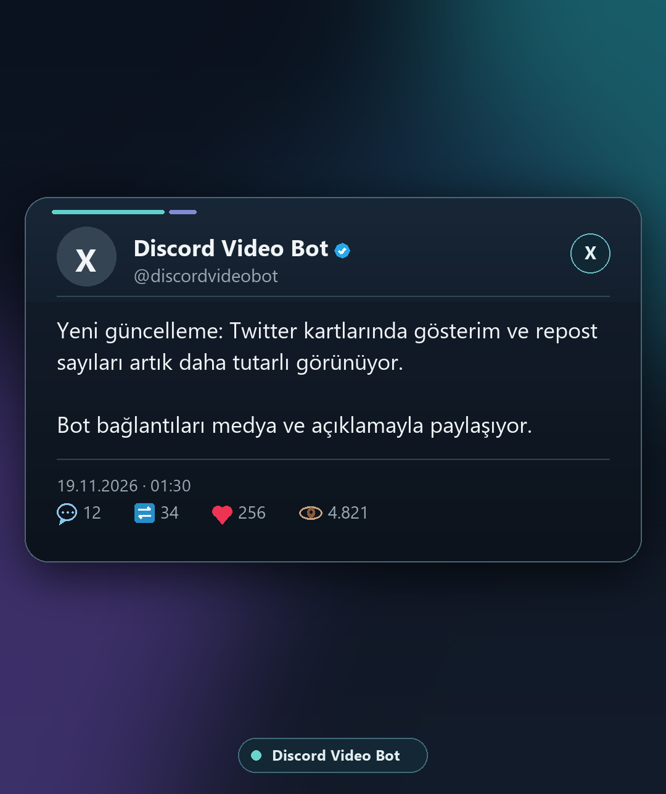

# Discord Video Downloader

Discord sohbetindeki sosyal medya bağlantılarını algılayıp medyayı ve erişilebilen gönderi metnini paylaşan Python botu. Platforma göre birden fazla ücretsiz sağlayıcıyı dener; ilk kullanılabilir tam sonucu gönderir.

## Desteklenen bağlantılar

| Platform | Bağlantı | Çıktı |
| --- | --- | --- |
| Instagram | Gönderi, reel, video, hikâye, öne çıkanlar | Fotoğraf/video galerisi, açıklama, kaynak düğmesi. Hikâyeler çerezsiz InDown ile, öne çıkanlar anahtarsız `indown.io` görüntüleyicisiyle alınır. |
| TikTok | Video, fotoğraf | Medya galerisi, açıklama, kaynak düğmesi |
| Facebook | Gönderi, reel, video, fotoğraf | Medya galerisi, erişilebilen açıklama, kaynak düğmesi |
| X / Twitter | Tweet | Koyu tweet PNG kartı; varsa medya ayrıca |
| Reddit | Gönderi ve `/r/.../s/...` kısa bağlantısı | Metin koyu PNG sayfalarında; varsa medya ayrıca |
| YouTube | Video, Shorts, canlı yayın bağlantısı | MP3, 360p, 720p, 1080p düğmeleri |
| Spotify | Tekil parça | Eşleşen YouTube kaydından MP3, doğrudan dosya eki |
| Threads | Gönderi ve `/share/`, `/t/` ve `/s/` bağlantısı | Normal gönderileri önce çerezsiz `threadsdl` web sağlayıcısıyla indirir; gerekirse oturumlu sayfa çözümlemesini dener. `/share/` bağlantısını `COOKIE_FILE` içindeki oturumla gerçek gönderiye çözer; çerez olmadan bu kısa bağlantı biçimi çalışmayabilir. Yeni `/s/<token>` kısa biçimi (`highlight:<id>`, `post:<id>` gibi) da aynı akışla çözülür. |
| Douyin | Video, not | `yt-dlp` ve doğrudan sayfa yolları |
| Weibo | Gönderi | `gallery-dl` ve `yt-dlp` |
| Streamable | Video | Streamable API ve `yt-dlp` |
| Bluesky | Gönderi | Resmî açık API’den metin, alt metinli fotoğraf galerisi ve MP4 video; kaynak düğmesi |

Profil, arama, tüm albüm ve oynatma listesi bağlantıları topluca indirilmez. Özel gönderiler, oturum isteyen içerikler ve bölgesel engeller başarısız olabilir.



## Gereksinimler

- Python 3.11+.
- [FFmpeg](https://ffmpeg.org/download.html) ve `ffprobe` PATH üzerinde. Ses dönüştürme ve bazı videolarda ses/görüntü birleştirme için gerekir.
- Discord uygulaması, bot token'ı ve **Message Content Intent**.
- İsteğe bağlı: [Cobalt](https://github.com/imputnet/cobalt) için Docker veya Bun. Cobalt olmadan diğer sağlayıcılar çalışır. WSL zorunlu değildir.

Botun Python modülü Windows, Linux ve macOS'ta çalıştırılabilir. `.ps1` başlatma betikleri Windows içindir.

## Discord kurulumu

1. [Discord Developer Portal](https://discord.com/developers/applications) üzerinde uygulama ve bot oluşturup token alın.
2. **Bot → Privileged Gateway Intents → Message Content Intent** seçeneğini açıp kaydedin. Aksi halde `PrivilegedIntentsRequired` hatası alınır.
3. Botu sunucuya **View Channels**, **Read Message History**, **Send Messages** ve **Attach Files** izinleriyle ekleyin. Kanal izinlerini ayrıca kontrol edin.

## Windows'ta çalıştırma

PowerShell'de proje klasöründe:

```powershell
py -3 -m venv .venv
.\.venv\Scripts\python.exe -m pip install -r requirements.txt
Copy-Item .env.example .env
```

`.env` dosyasındaki `DISCORD_TOKEN` değerini kendi token'ınızla doldurun. `ffmpeg -version` komutunun çalıştığını kontrol edin.

```powershell
.\start-bot.ps1
```

Botu `Ctrl+C` ile durdurabilirsiniz. Linux/macOS'ta sanal ortamı etkinleştirip `python -m media_bot.bot` çalıştırın. Botun çevrimiçi kalması için çalıştığı makine açık kalmalıdır. Windows'ta indirme/ffmpeg gecikmesini azaltmak için yönetici PowerShell'de `.\scripts\defender-exclusions.ps1` çalıştırabilirsiniz (proje, `data`, `.venv`, `vendor` ve python/ffmpeg süreçleri için Defender istisnası ekler).

## 7/24 çalıştırma ve izleme

Botu oturum açıldığında otomatik başlatmak ve çökünce yeniden denemek için:

```powershell
powershell -ExecutionPolicy Bypass -File .\scripts\install-autostart.ps1
# Kaldırmak için:
powershell -ExecutionPolicy Bypass -File .\scripts\uninstall-autostart.ps1
```

Görev, `scripts\run-bot-loop.ps1` betiğini çalıştırır. Betik bir mutex ile ikinci bir bot kopyasının açılmasını engeller, hata kodunda 5–60 sn artan bekleme ile yeniden dener ve olayları `data/autostart.log` dosyasına yazar. Elle `start-bot.ps1` çalıştırıyorsanız önce görevi durdurun.

**Günlük dosyası:** `data/bot.log` varsayılan olarak 10 MB'ta döner ve 7 eski dosya tutar (`LOG_FILE`, `LOG_LEVEL`).

**Sağlık uç noktası:** `HEALTH_PORT` sıfırdan büyükse `http://127.0.0.1:<port>/healthz` JSON döner: durum, uptime, sunucu sayısı, gecikme, açık devre kesiciler, Cobalt yapılandırması, bakım modu ve çerez sayıları. Varsayılan kapalıdır; dışarıya açmadan önce güvenlik duvarını ve ters vekili düşünün.

**Yedekler:** Bot her `BACKUP_INTERVAL_HOURS` saatte (varsayılan 24) `bot.sqlite3`, `provider_metrics.sqlite3` ve `request_log.sqlite3` dosyalarını `data/backups/<tarih>/` altına `sqlite3.Connection.backup` ile kopyalar; `BACKUP_KEEP` kadar klasör saklar. Geri yüklemek için botu durdurup ilgili dosyayı `data/` altına kopyalayın.

**Çerez uyarısı:** Açılışta `COOKIE_FILE` Netscape biçiminde değilse, süresi dolmuşsa veya 3 gün içinde dolacaksa bot sahibine DM ve günlük uyarısı gönderir.

## `.env` ayarları

| Değişken | Varsayılan | Görevi |
| --- | --- | --- |
| `DISCORD_TOKEN` | Yok | Zorunlu bot token'ı |
| `CHANNEL_IDS` | Boş | Virgülle ayrılmış kanal ID'leri; boşsa erişilebilen tüm sunucu metin kanalları |
| `MAX_UPLOAD_MB` | `0` | `0` ise sunucunun gerçek yükleme limiti (`guild.filesize_limit`) kullanılır; `0`'dan büyük değer tüm sunucularda üst sınır (MB) olur |
| `COMMAND_GUILD_ID` | Boş | Slash komutlarını yalnızca bu sunucuya eşitler; boşsa global eşitlenir |
| `COMMAND_COOLDOWN_SECONDS` | `2` | `!` komutları için kullanıcı başı bekleme süresi; `0` kapatır |
| `YTDLP_REMOTE_EJS` | `0` | `1` olursa YouTube `yt-dlp` yedeği gerektiğinde GitHub’dan EJS betiği indirebilir; varsayılan kapalıdır |
| `MAX_LINKS_PER_MESSAGE` | `3` | Tek mesajda işlenen bağlantı sayısı; en fazla 10 |
| `MAX_CONCURRENT_JOBS` | `2` | Mesaj ve YouTube düğmesi işleri için toplam eşzamanlı sınır; en fazla 10 |
| `PROVIDER_HEDGE_SECONDS` | Boş | Son başarılı sağlayıcı tek başına denenir; boşsa ölçülen p95'e göre 3–20 sn arasında uyarlanır. Sabit değer yazılırsa o kullanılır; `0` = beklemeden yarış (YouTube MP3 varsayılanı `5`) |
| `DATABASE_PATH` | `data/bot.sqlite3` | +18 kotası ve highlight quota/cache durumu için SQLite dosyası |
| `COBALT_API_URL` | Boş | İsteğe bağlı Cobalt adresi, örn. `http://127.0.0.1:9000/` |
| `COBALT_API_KEY` | Boş | Cobalt örneği gerektiriyorsa anahtar |
| `COOKIE_FILE` | Boş | Erişim hakkınız olan hesabın çerez dosyası: Netscape biçimi veya tarayıcıdaki `Cookie:` başlığının tek satırlık ham hâli. Threads `/share/` bağlantıları ve oturum gerektiren gönderiler için kullanılır. |
| `GALLERY_DL_RS_PATH` | Boş | İsteğe bağlı `gallery-dl-rs` program yolu |
| `HIGHLIGHT_CACHE_TTL_HOURS` | `12` | Çerezsiz Instagram highlight sonuçları için disk önbelleği süresi (saat) |
| `HIGHLIGHT_CACHE_MAX_MB` | `512` | Highlight disk önbelleği toplam boyut sınırı (MB) |
| `HIGHLIGHT_HOURLY_LIMIT` | `4` | Kullanıcı başı saatlik highlight indirme limiti |
| `HIGHLIGHT_DAILY_LIMIT` | `15` | Kullanıcı başı günlük highlight indirme limiti |
| `HIGHLIGHT_HEALTHCHECK_ENABLED` | `1` | indown.io highlight sağlık kontrolünü aç/kapat (`0` kapatır) |
| `HIGHLIGHT_HEALTHCHECK_HOURS` | `24` | Sağlık kontrolü aralığı (saat); kontrol indirmesiz resolve yapar ve kota harcayabilir |
| `HIGHLIGHT_HEALTHCHECK_RESERVE` | `3` | Sağlık kontrolünün kullanıcılar için ayırdığı minimum bucket jetonu |
| `MEDIA_CACHE_TTL_MINUTES` | `360` | Aynı URL tekrarları için genel medya önbelleği süresi (dakika); 6 saat, en fazla 7 gün |
| `MEDIA_CACHE_MAX_MB` | `1024` | Genel medya önbelleği toplam boyut sınırı (MB) |
| `CARD_CACHE_TTL_MINUTES` | `30` | X/Reddit kart PNG önbelleği süresi (dakika); en fazla 1 gün |
| `CARD_CACHE_MAX_MB` | `256` | X/Reddit kart önbelleği toplam boyut sınırı (MB) |
| `USER_HOURLY_LIMIT` | `30` | Kullanıcı başına saatlik genel bağlantı limiti; `0` kapatır |
| `USER_DAILY_LIMIT` | `200` | Kullanıcı başına günlük genel bağlantı limiti; `0` kapatır |
| `STATS_OWNER_ID` | `1065352859195015260` | `!stats` / `!panel` ve başka kullanıcının `!info` sorgusunu kullanabilecek tek Discord kullanıcı ID'si |
| `MAINTENANCE_MODE` | *(boş)* | `1` ise bot açılışta bakım modunda başlar; boşsa son durum `data/maintenance.json` dosyasından okunur |
| `MAINTENANCE_MESSAGE` | *(varsayılan metin)* | Bakım açıkken kullanıcılara gösterilecek özel mesaj |
| `REQUEST_LOG_RETENTION_DAYS` | `30` | İşlem kayıtlarının saklanma süresi (gün) |
| `REQUEST_LOG_STORE_URL` | `1` | `0` ise işlem kayıtlarında URL saklanmaz (platform/sonuç yine tutulur) |
| `LOG_FILE` | `data/bot.log` | Dönen günlük dosyası (10 MB × 7); boş/`0` ise yalnızca konsol |
| `LOG_LEVEL` | `INFO` | `DEBUG`, `INFO`, `WARNING`, `ERROR` |
| `HEALTH_HOST` | `127.0.0.1` | `/healthz` uç noktasının dinleyeceği adres |
| `HEALTH_PORT` | `0` | Sağlık uç noktası portu; `0` kapalı |
| `BACKUP_ENABLED` | `1` | Günlük SQLite yedeği (`data/backups/`) açık/kapalı |
| `BACKUP_INTERVAL_HOURS` | `24` | Yedek aralığı (saat) |
| `BACKUP_KEEP` | `7` | Saklanan yedek klasörü sayısı |

Kanal ID'si ve Cobalt anahtarı zorunlu değildir. Gerçek `.env`, çerezler, SQLite veritabanı ve geçici indirmeler Git'e eklenmez.

**Threads çerezi (isteğe bağlı):** `/share/...` kısa bağlantıları yalnızca giriş yapmış bir istemciye gerçek gönderiyi gösterir. Tarayıcıda threads.com'a giriş yapın, DevTools → Network → herhangi bir isteğin `Cookie:` başlığını kopyalayın, tek satır olarak bir dosyaya kaydedin ve `COOKIE_FILE` değişkenine o dosyanın yolunu yazın. Netscape biçimli `cookies.txt` de kabul edilir; ham başlık dosyası yalnızca botun kendi HTTP istemcilerinde kullanılır, `yt-dlp`/`gallery-dl` bu biçimi okuyamadığı için onlara verilmez. Bot gönderi sayfasından her işlemde güncel medya adresleri alır; eski Instagram CDN bağlantılarını saklamaz. Oturum çerezi Threads tarafından geçersiz kılınırsa dosyayı yenilemek gerekir.

## Cobalt (isteğe bağlı)

Docker ile yerel Cobalt çalıştırmak için:

```powershell
docker compose -f cobalt.compose.yaml up -d
```

`.env` içine `COBALT_API_URL=http://127.0.0.1:9000/` ekleyin. Durdurmak için `docker compose -f cobalt.compose.yaml down` kullanın. Docker istemiyorsanız Cobalt kaynakları `vendor/cobalt` altında hazırken `start-cobalt.ps1` Bun ile yerel API'yi açar. `start-bot.ps1` yerel Cobalt adresi ayarlıysa onu başlatmayı dener; başarısız olursa bot diğer sağlayıcılarla devam eder. `stop-cobalt.ps1` yerel Bun sürecini durdurur.

`start-cobalt.ps1`, Cobalt 11.7.1 kaynaklarındaki Bun uyumluluk düzeltmelerini gerektiğinde uygular. Cobalt API'sinin Bun 1.4.4 ile açıldığı yerel sağlık kontrolünde doğrulandı. YouTube çıkarıcısı `isolated-vm` gerektirdiğinde Bun altında çalışmayabilir; botun diğer YouTube sağlayıcıları kullanılabilir. `vendor/` kaynak kopyası bu depoya gönderilmez.

## Mesaj düzeni ve sınırlar

- Fotoğraf ve videolar **Discord Components V2 Media Gallery** içinde, erişilebilen açıklama ve **Kaynak** bağlantı düğmesiyle gönderilir. Tek videolu Instagram reels mesajında video üstte, açıklama ve kaynak düğmesi alttaki küçük karttadır. Piksel içindeki yazı OCR ile okunmaz; gönderi açıklaması alınır.
- YouTube 360p/720p/1080p düğmeleri üst çözünürlük sınırıdır. Dosya yükleme sınırına sığan daha düşük bir kalite seçilebilir; bot gönderilen MP4 dosyasının adına ve durum kartına gerçek çözünürlüğü yazar.
- Bir gönderiden en çok **100 dosya** alınır. Discord'un mesaj başına 10 dosya sınırı için dosyalar 10'arlı mesajlara bölünür. Uzun açıklamalar metin sınırına göre devam mesajlarına ayrılır.
- X tweet metni, alıntılar, profil fotoğrafları, mavi tikler ve erişilebilen sayaçlar koyu PNG karta çizilir. Medya varsa ayrıca yüklenir.
- Reddit metni alınabildiğinde koyu PNG sayfalarına çizilir. Birden çok sayfa aynı Media Gallery mesajındadır; 10 sayfadan sonra yeni mesaj açılır. [Reddit RSS desteğini 13 Kasım 2026'da sonlandıracağını duyurdu](https://www.reddit.com/r/modnews/comments/1xuj8jp/mod_monthly_your_november_2026_newsletter_is_here/); arşiv yedekleri yeni gönderilerde gecikebilir. Reddit desteği bu yüzden en iyi çabadır.
- YouTube düğmelerini yalnızca bağlantıyı gönderen kişi kullanır. Düğmeler beş dakika geçerlidir. MP3 128 kb/sn hazırlanır; dosya embed/kart içine konmaz, **doğrudan normal ek** olarak ve `Sanatçı - Şarkı.mp3` adıyla gönderilir. Çözünürlük düğmeleri üst sınırdır.
- YouTube sağlayıcı seçimi öğrenmelidir: son başarılı sağlayıcı (kalite bazında) önce **tek başına** denenir; yalnızca başarısız olursa veya tercih edilen sağlayıcının ölçülen p95 süresine göre belirlenen bekleme (boşsa 3–20 sn) aşılırsa diğerleri devreye girer. Böylece her istekte tüm sağlayıcılar denenmez.
- Bu öğrenme tüm platformlarda geçerlidir: son kazanan sağlayıcı bağlam bazında (Instagram reel/story/highlight/post, Threads kısa/gönderi, diğer platformlar) hatırlanır ve `data/provider_metrics.sqlite3` içindeki `provider_winners` tablosunda saklanır. Bot yeniden başlasa da tercih korunur. Sağlayıcı sırası, son 24 saatteki başarılı denemelerin p95 süresine göre de güncellenir; `PROVIDER_HEDGE_SECONDS` boşsa bekleme süresi de bu p95'ten türetilir (3–20 sn).
- Spotify'ın korumalı ses akışı indirilmez. Bot parça adı, sanatçı ve süreyle YouTube'da tam uzunlukta kayıt arar; uygun eşleşmeyi MP3 dosyası olarak **doğrudan ekler**, embed kullanmaz. Kayıplı kaynaktan gerçek FLAC üretilemeyeceği için FLAC etiketi kullanılmaz.
- Sağlayıcılar kısa aralıklarla yarışır; ilk eksiksiz sonuç alınır. Platformlar ve web servisleri değişebildiğinden kesintisiz başarı garantisi yoktur. Sağlayıcı sırası ve araştırma notları [PROVIDERS.md](PROVIDERS.md) içindedir.
- Instagram gönderilerinde açıklamadaki like/yorum sayıları ve `@kullanıcı · tarih` ön eki tırnakları yok sayılarak kırpılır; hikâye ve öne çıkan kartlarında açıklama yok sayılır, **`@kullanıcı · tarihi`** ile footer verilir. Kaynak düğmesi footerda aynı kartın yanındadır.
- Çerezsiz Instagram öne çıkanlar `indown.net` ile denenir, gerekirse `indown.io`ya düşer (`~20/saat` IP kotası). Aynı highlight tekrarlarında disk önbelleği ve eşzamanlı istek birleştirme (single-flight) kota tüketimini azaltır; kullanıcı başı saatlik/günlük limitler ve kalan süreli kota mesajları uygulanır. indown.io kotası tamamen sınırsız değildir.
- Dosyalar geçici klasörde işlenip Discord'a gönderildikten sonra silinir. Bot medya arşivi tutmaz (highlight ve kısa süreli genel medya önbellekleri TTL/boyut sınırıyla temizlenir).
- Discord dosyayı yine de "çok büyük" diye reddederse (413), bot videoyu daha düşük bit hızı/480p ile yeniden kodlayıp bir kez daha dener; yine olmazsa sınır mesajı gösterir.
- Aynı kullanıcı için aynı anda yalnızca bir iş çalışır; sonraki istek sıraya alınır ve geçici durum mesajı gösterilir. Tek mesajdaki birden çok bağlantı ikişerli paralel işlenir ve hazır olan dosya beklemeden yüklenir. Farklı kullanıcılar `MAX_CONCURRENT_JOBS` sınırına kadar paralel işlenir. Aynı bağlantıyı farklı kullanıcılar gönderirse şu anda ayrı indirme yapılır.

## Sunucu ayarları (`/ayar`, `!ayar`)

- Yöneticiler (`Sunucuyu yönet` veya bot sahibi) `!ayar thread ac|kapat`, `!ayar youtube sor|mp3|360|720|1080` ve `!ayar dil tr|en|auto` ile sunucu bazlı tercihleri ayarlar; `!ayar` mevcut ayarları gösterir. Slash komutu `/ayar otomatik_thread:`, `/ayar youtube:` ve `/ayar dil:` aynı işi yapar.
- Otomatik thread açıksa, bağlantılı bir mesajın altında bir thread açılır ve sonraki yanıtlar oraya yönlendirilir.
- YouTube kalitesi `sor` dışında bir değer seçildiğinde düğme penceresi atlanır ve varsayılan kalite doğrudan indirilir. `sor` durumunda kullanıcıya MP3/360/720/1080 düğmeleri gösterilir.
- Dil ayarı `tr`/`en`/`auto` olabilir. Sunucu ayarı yoksa veya `auto` seçilirse varsayılan Türkçe kullanılır; Türkçe ve İngilizce durum, hata, kota ve ayar metinleri hazırdır.

## +18 koruması ve SQLite

Reddit gönderisi veya subreddit +18 işaretliyse bağlantı yalnızca **NSFW kanalda** veya o kanalın thread'inde işlenir. Kullanıcı başına **Türkiye saatine göre günde bir +18 işlem** hakkı vardır. Hak işlem başladığında tüketilir ve sayaç `DATABASE_PATH` içindeki SQLite dosyasında atomik tutulur; MongoDB sunucusu gerekmez.

Reddit'in +18 durumu doğrulanamazsa bağlantı işlenmez. Bu denetim **Reddit'e özgüdür**; diğer platformlardaki işaretsiz yetişkin içeriğini güvenilir biçimde sınıflandırmaz.

## Kod haritası

| Yol | Görevi |
| --- | --- |
| `media_bot/bot.py` | `MediaBot` çekirdeği, başlatma/health/yaşam döngüsü, uyumluluk re-export’ları |
| `media_bot/bot_orchestration_mixin.py` | Mesaj orkestrasyonu (`on_message`), kuyruk/işleme akışı, `_reply` yardımcıları |
| `media_bot/bot_commands_mixin.py` | Yönetim/ayar/istatistik komut yanıtları ve yardımcıları |
| `media_bot/bot_link_handlers_mixin.py` | Platform/link işleyicileri ve medya teslim akışları |
| `media_bot/bot_slash_commands.py`, `media_bot/bot_entrypoint.py`, `media_bot/bot_runtime.py` | Slash komut kaydı, giriş noktası ve çalışma zamanı yardımcıları |
| `media_bot/discord_support.py`, `media_bot/i18n.py` | Components V2/UI yardımcıları, adaptörler ve yerelleştirme |
| `media_bot/links.py` | Bağlantı tanıma ve normalleştirme |
| `media_bot/download.py`, `race.py`, `circuit_breaker.py`, `provider_memory.py` | Sağlayıcı seçimi, indirme yarışı, öğrenme ve arıza soğuması |
| `media_bot/direct_providers.py`, `web_providers.py`, `cobalt.py`, `gendownload.py`, `indownio.py` | İndirme sağlayıcıları |
| `media_bot/youtube.py`, `youtube_view.py`, `spotify.py` | YouTube seçenekleri/teslimi ve Spotify eşleştirmesi |
| `media_bot/reddit_post.py`, `reddit_card.py`, `x_card.py`, `x_story.py`, `bluesky.py` | Platforma özel içerik, kart ve API işleme |
| `media_bot/captions.py`, `metadata_fallback.py`, `limits.py`, `video_fit.py` | Açıklama, önizleme, boyut/sınır ve video uyarlama |
| `media_bot/media_cache.py`, `highlight_state.py`, `maintenance.py`, `guild_settings.py` | Önbellek, highlight/kota durumu, bakım modu ve sunucu ayarları |
| `media_bot/provider_metrics.py`, `request_log.py` | Sağlayıcı metrikleri ve işlem kayıtları |
| `media_bot/http.py`, `sqlite_util.py`, `job_slots.py`, `cooldowns.py` | HTTP/SQLite yardımcıları, eşzamanlılık ve komut soğuması |
| `media_bot/health.py`, `backup.py`, `cookiefile.py`, `retry_view.py` | Sağlık uç noktası, yedekleme, çerez kontrolü ve tekrar dene UI |
| `scripts/`, `tests/` | Yardımcı betikler ve testler |

Firefox eklentisi ayrı bir yerel çalışma klasörüdür; `.gitignore` içinde tutulur ve bu repoya dahil edilmez.

## Test ve sorun giderme

Bot çalışırken her sağlayıcı denemesinin sonucu ve süresi `data/provider_metrics.sqlite3` içine kaydedilir. Bu dosyada gönderi bağlantısı, Discord kullanıcı kimliği veya medya bulunmaz. Son 24 saati görmek için:

```powershell
.\.venv\Scripts\python.exe -m media_bot.provider_metrics
```

`DATABASE_PATH` farklı bir klasörü gösteriyorsa raporda `--db <o klasör>\provider_metrics.sqlite3` kullanın. `--hours 48` veya `--hours 168` gibi bir aralık seçilebilir. Rapor platform ve sağlayıcı başına deneme sayısını, kazanan sağlayıcıyı, `quota`/`skipped`/arıza ayrımını ve başarılı denemelerin p50/p95 sürelerini gösterir (`quota` = gerçek kota aşımı; `skipped` = cooldown/reserve vb. atlanan denemeler). 14 günden eski ölçümler bot açılışında ve çalışırken günde bir kez temizlenir. Rapor ağ isteği yapmaz.

Discord içinden izin verilen kanalda `!metrics` / `!durum` yazarak son 24 saat ve 7 gün özetini (varsa highlight bucket durumu dahil) görebilirsiniz.

### İşlem kayıtları (sunucu/kullanıcı/link)

Bot, işlenen her bağlantı için `data/request_log.sqlite3` dosyasına kayıt tutar: zaman, sunucu, kanal, kullanıcı, platform, URL, sonuç (`success`/`failure`/`pending`), işlem süresi, dosya sayısı ve toplam boyut. Bu dosya **URL ve kullanıcı/sunucu bilgisi içerir** (sağlayıcı metrik dosyasından farklıdır). Saklama süresi `REQUEST_LOG_RETENTION_DAYS` (varsayılan 30 gün); `REQUEST_LOG_STORE_URL=0` ile URL'ler hiç kaydedilmez.

Discord komutları (izin verilen kanalda):
- `!yardim` / `!help` → komut listesi ve desteklenen platformlar.
- `!stats` / `!istatistik` / `!panel` / `!admin` → yönetim paneli: toplam kullanıcı/sunucu, bugün aktif, toplam istek, başarılı/başarısız, başarı yüzdesi ve platform kırılımı. **Yalnızca `STATS_OWNER_ID`** kullanabilir.
  - Aralık: `!stats 24s`, `!stats 7g`, `!stats 30g` (en fazla 30 gün; `s` = saat, `g` = gün).
  - Platform detayı: `!stats instagram`, `!stats 7g instagram` veya `!platform instagram 30g` → o platformun toplam/başarı oranı, dosya-boyut, ortalama süre, kullanıcı/sunucu sayısı ve en çok kullananlar.
- `!info` / `!profil` / `!me` → kendi işlem özetiniz (`!info 7g` ile aralık). `!info @kullanıcı` veya `!info <kullanıcı_id>` ile başka kullanıcı sorgusu **yalnızca `STATS_OWNER_ID`** için açıktır.
- `!metrics` / `!durum` → sağlayıcı ve highlight bucket özeti.
- `!bakim` → bakım modu durumu; `!bakim ac` / `!bakim kapat` ile aç/kapat. **Yalnızca `STATS_OWNER_ID`**. Bakım açıkken sahip dışındaki kullanıcıların yeni indirmeleri engellenir (panelde “Bakım: Açık” görünür).
- `!logtemizle` → tüm işlem kayıtlarını silme onayı; `!logtemizle onay` ile siler. **Yalnızca `STATS_OWNER_ID`**.
- `!logsil` → kendi kayıtlarını silme onayı; `!logsil onay` ile siler. `!logsil @kullanıcı` / `!logsil <id>` başka kullanıcının kayıtlarını siler (**yalnızca sahip**).
- `!hatalar` → son 24 saatteki başarısız işlemler (platform, kullanıcı, sunucu, kısa neden). `!hatalar 7g` ile aralık verilebilir. **Yalnızca `STATS_OWNER_ID`**.
- `!cache` / `!önbellek` → genel medya ve highlight önbelleğinin kayıt/dosya/boyut ve TTL bilgisi.
- `!cachetemizle` / `!önbellektemizle` → her iki önbelleği temizler. **Yalnızca `STATS_OWNER_ID`**.
- Başarısız bir indirmeden sonra bot, bağlantıyı paylaşan kişi (ve sahip) için **🔁 Tekrar dene** butonu gönderir; buton aynı bağlantıyı yeniden işler ve sonucu ayrı bir işlem kaydı olarak yazar.

**Slash komutlar:** `/yardim`, `/stats`, `/info`, `/cache`, `/cachetemizle`, `/hatalar`, `/bakim`, `/metrics` aynı işlevleri buton/argüman desteğiyle sunar. Eşitleme açılışta otomatik yapılır; komutların anında görünmesi için `.env` içine `COMMAND_GUILD_ID=<sunucu_id>` yazın (boşsa global eşitlenir ve Discord'un önbelleği yüzünden bir süre gecikebilir). `!` komutları için kullanıcı başı `COMMAND_COOLDOWN_SECONDS` (varsayılan 2 sn) spam koruması uygulanır; sahip muaftır.

**Yükleme limiti:** `MAX_UPLOAD_MB=0` (varsayılan) iken bot, mesajın geldiği sunucunun gerçek limitini (`guild.filesize_limit`) kullanır. Böylece 10 MB'lık sunucuda boş yere 20 MB dosya indirilmez, 50 MB'lık sunucuda da gereksiz küçültme yapılmaz. Daha büyük bir değer verirseniz tüm sunucularda üst sınır olur.

Kayıtlar tek bir SQLite dosyasında tutulur ama her satır `user_id` (ve `guild_id`) ile ilişkilidir; `!info` yalnızca ilgili kullanıcının satırlarını toplar.

Komut satırından:

```powershell
.\.venv\Scripts\python.exe -m media_bot.request_log
.\.venv\Scripts\python.exe -m media_bot.request_log --range 7g
.\.venv\Scripts\python.exe -m media_bot.request_log --hours 168
.\.venv\Scripts\python.exe -m media_bot.request_log --platform instagram --range 30g
.\.venv\Scripts\python.exe -m media_bot.request_log --user 123456789012345678
.\.venv\Scripts\python.exe -m media_bot.request_log --range 7g --export-csv data/loglar.csv
.\.venv\Scripts\python.exe -m media_bot.request_log --range 30g --export-json data/loglar.json
```

`DATABASE_PATH` farklıysa `--db <o klasör>\request_log.sqlite3` kullanın.

```powershell
.\.venv\Scripts\python.exe -m unittest discover -s tests -p "test_*.py"
```

Testler, üçüncü taraf web servislerinin her zaman çalışacağını garanti etmez; canlı testi herkese açık bir bağlantıyla ayrıca yapın.

## CI ve benchmark

Her `push` / `pull_request` aşamasında [`.github/workflows/ci.yml`](.github/workflows/ci.yml) şu adımları çalıştırır:

- `ruff check` — kod kalitesi ve kullanılmayan içe aktarma denetimi (`pyproject.toml` ile yapılandırılmış)
- `python -m unittest discover -s tests -q` — tüm birim ve akış testleri

İş akışı `windows-latest` ve `ubuntu-latest` üzerinde Python 3.12 ile çalışır.

### Benchmark

`scripts/benchmark.py`, sabit bir bağlantı listesini `download_media` üzerinden ölçüp sağlayıcı bazlı p50/p95 süre raporu üretir:

```powershell
# links.txt oluştur: satır başına bir bağlantı
@'
https://www.youtube.com/watch?v=dQw4w9WgXcQ
https://www.tiktok.com/@user/video/123456789
'@ | Set-Content links.txt -Encoding utf8

\.venv\Scripts\python.exe scripts\benchmark.py links.txt rapor.json
```

Çıktı `rapor.json` dosyasına yazılır ve konsola sağlayıcı başına ortalama/p95 süreleri basılır. Discord'a bağlanma gerekmez; yalnızca indirme çekirdeği çalıştırılır.

- **Bot açılmıyor:** Message Content Intent ve token'ı kontrol edin.
- **Bot yanıt vermiyor:** Desteklenen tekil bağlantı biçimini, kanal izinlerini ve `CHANNEL_IDS` filtresini kontrol edin.
- **Dosya yüklenmiyor:** Discord'un yükleme sınırı ve `MAX_UPLOAD_MB` değerini kontrol edin.
- **YouTube/Spotify 403:** Bot birden fazla sağlayıcı ve oynatıcı istemcisi dener. Gerekirse `yt-dlp` güncelleyin; kendi erişim hakkınız olan çerezleri `COOKIE_FILE` ile verin.
- **Cobalt başlamıyor:** `vendor/cobalt/api/cobalt.stderr.log` dosyasını, Bun kurulumunu ve `127.0.0.1:9000` durumunu kontrol edin.
- **Reddit işlenmiyor:** +18 bilgisi doğrulanamazsa veya kanal NSFW değilse bot bağlantıyı reddeder.

Token, çerez dosyası, SQLite veritabanı ve indirilen medya dosyalarını repoya göndermeyin.
